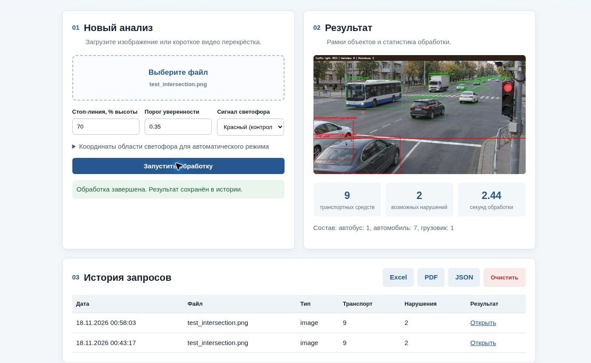

# Детектор проезда на красный свет

Веб-приложение для детекции транспорта и возможных случаев проезда за стоп-линию при красном сигнале светофора.



## Возможности

- загрузка изображения или видео через браузер;
- детекция автомобилей, мотоциклов, автобусов и грузовиков моделью YOLOv8;
- обработка кадров средствами OpenCV;
- нанесение рамок объектов и стоп-линии;
- ручной контрольный режим красного сигнала или определение красного цвета в указанной ROI;
- сохранение истории запросов в SQLite;
- экспорт истории в Excel, PDF и JSON.

## Запуск в Windows

1. Установить Python 3.10 или более новую версию.
2. Скачать проект и распаковать архив.
3. Запустить `start.bat`.
4. После установки зависимостей открыть `http://127.0.0.1:5000`.

При первом запуске установка библиотек может занять несколько минут.

## Ручной запуск

```bash
python -m venv .venv
.venv\Scripts\activate
pip install -r requirements.txt
python app.py
```

## Структура проекта

- `app.py` - маршруты Flask и обработка запросов;
- `utils/detector.py` - YOLOv8, OpenCV и визуализация;
- `utils/database.py` - история запросов SQLite;
- `utils/exporters.py` - экспорт PDF и Excel;
- `templates/index.html` - веб-страница;
- `static/css/style.css` - оформление;
- `static/js/app.js` - отправка формы и вывод результата;
- `test_intersection.png` - контрольное изображение.

## Проверка

Для быстрой проверки загрузите `test_intersection.png`, оставьте режим «Красный (контрольный тест)», стоп-линию 70 % и порог уверенности 0.35.

Для проверки видео можно использовать файл `Перекресток.mov`.

Программа создана в рамках учебной практики.
